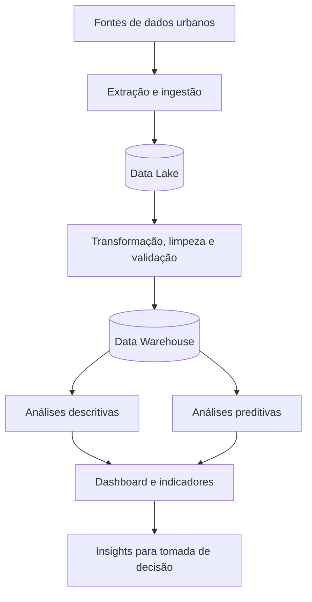

<div align="center">

# 🏙️ Smart Cities 

### Transformando dados urbanos em decisões mais inteligentes

**Arquitetura de dados · ETL · Big Data · Analytics · Visualização · Privacidade**


</div>

---

## 🌐 Visão geral

Como transformar grandes volumes de informações sobre uma cidade em decisões que realmente melhorem a vida das pessoas?

O **Smart Cities** é uma proposta de solução orientada a dados para apoiar a gestão urbana. O projeto explora como integrar diferentes fontes de informação, organizar dados históricos e produzir análises capazes de revelar padrões, antecipar cenários e apoiar decisões mais fundamentadas.

A solução será desenvolvida em torno de um **desafio realista de cidade inteligente**, a ser definido pelo grupo. O objetivo não é apenas apresentar gráficos, mas construir uma proposta coerente desde a origem dos dados até a comunicação dos insights, considerando qualidade, rastreabilidade e privacidade.

> **Nossa proposta:** transformar dados dispersos em informações úteis, acessíveis e orientadas à melhoria da qualidade de vida da população.

### 🎯 Desafio e recorte do projeto

| Definição | Descrição |
|---|---|
| **Eixo temático** | `[Definir: trânsito, saúde, educação, emprego e renda, esportes, cultura, ordem pública/manutenção ou turismo]` |
| **Problema central** | `[Descrever o problema urbano que será investigado]` |
| **Público beneficiado** | `[Ex.: gestores públicos, moradores, equipes de planejamento]` |
| **Dados utilizados** | `[Informar bases, fontes e períodos analisados]` |
| **Resultado esperado** | `[Descrever as decisões ou melhorias que as análises poderão apoiar]` |

## 💡 O que a solução propõe

O projeto será estruturado em quatro frentes complementares:

1. **Integração de dados:** reunir fontes estruturadas e não estruturadas relevantes para o problema escolhido.
2. **Preparação e confiabilidade:** definir um processo ETL para extrair, limpar, padronizar e organizar os dados antes da análise.
3. **Inteligência analítica:** propor análises descritivas e preditivas que ajudem a compreender tendências e apoiar decisões.
4. **Comunicação dos resultados:** desenhar um dashboard e construir uma narrativa de *data storytelling* compreensível para públicos não técnicos.

A proposta também deverá considerar riscos éticos e boas práticas de proteção de dados desde a concepção.

## 🏗️ Arquitetura conceitual

O desenho abaixo representa o **fluxo proposto**, sujeito a ajustes conforme o eixo temático e as fontes selecionadas.



### Data Lake e Data Warehouse

- **Data Lake:** camada proposta para armazenar dados de diferentes origens e formatos, preservando informações que poderão ser preparadas e exploradas posteriormente.
- **Data Warehouse:** camada proposta para disponibilizar dados organizados, integrados e adequados a consultas, indicadores e análises.

### Processo ETL

O processo de **Extração, Transformação e Carga** deverá documentar a origem dos dados, os tratamentos necessários (como remoção de duplicidades, padronização e validação) e sua disponibilização na camada analítica. O fluxograma detalhado será incluído na documentação técnica.

## 📊 Análises e experiência de visualização

O painel será pensado para responder perguntas concretas sobre o cenário selecionado, combinando:

| Componente | Finalidade |
|---|---|
| **Indicadores principais (KPIs)** | Resumir o desempenho ou a situação do problema estudado |
| **Evolução histórica** | Identificar mudanças e tendências ao longo do tempo |
| **Comparações e recortes** | Explorar diferenças entre regiões, períodos ou categorias, conforme os dados disponíveis |
| **Análises preditivas** | Propor estimativas de cenários futuros, com limitações explicitadas |
| **Data storytelling** | Explicar o significado dos resultados e suas possíveis implicações para a gestão |

**Pergunta norteadora:** `[Qual decisão prática o dashboard deve ajudar a tomar?]`

> Os indicadores, modelos e visualizações finais serão definidos após a escolha do problema e a avaliação das fontes de dados. Este README descreve a proposta, não funcionalidades já implementadas.

## 🔐 Ética, privacidade e LGPD

A solução deverá identificar os riscos associados ao uso dos dados e documentar medidas adequadas ao contexto, incluindo minimização da coleta, definição de finalidade, controle de acesso, proteção de informações pessoais e uso responsável dos resultados. O tratamento de dados será avaliado à luz dos princípios da **Lei Geral de Proteção de Dados (LGPD)**.

## 🗺️ Etapas do projeto

- [ ] Definir o eixo temático e o problema urbano com validação do professor.
- [ ] Identificar fontes e necessidades de dados.
- [ ] Elaborar o modelo conceitual de Data Lake e Data Warehouse.
- [ ] Desenhar o fluxograma de ETL e as regras de preparação dos dados.
- [ ] Propor indicadores e análises descritivas e preditivas.
- [ ] Criar o protótipo do dashboard.
- [ ] Preparar o roteiro de *data storytelling*.
- [ ] Documentar riscos éticos e diretrizes de adequação à LGPD.
- [ ] Consolidar o documento técnico e a apresentação.

## 📁 Organização do repositório

Estrutura **sugerida** para os artefatos do projeto, a ser criada conforme a necessidade:

```text
.
├── README.md
├── docs/                 # Documento técnico, arquitetura e LGPD
├── diagrams/             # Fluxogramas e diagramas conceituais
├── dashboard/            # Protótipos e referências visuais
└── presentation/         # Material da apresentação
```

## 👥 Equipe

| Integrante | Nome completo | RA |
|:--:|---|---|
| 1 | `Vinicius Lacerda Santos` | `12725210686` |
| 2 | `[Nome completo]` | `[RA]` |
| 3 | `[Nome completo]` | `[RA]` |
| 4 | `[Nome completo]` | `[RA]` |
| 5 | `[Nome completo]` | `[RA]` |

## 🎓 Contexto acadêmico e entregas

O projeto é desenvolvido para a avaliação **A3 da Unidade Curricular Análise de Dados e Big Data**. A atividade propõe uma solução de análise de dados voltada a cidades inteligentes, com apresentação em sala e entrega da documentação conforme os modelos disponibilizados pelo professor.

| Marco | Data |
|---|---|
| Formação das equipes e discussão dos eixos temáticos | **26/10/2026** |
| Apresentação do trabalho | **30/11/2026** |

**Entregáveis previstos:** documento técnico, arquitetura conceitual Lake/Warehouse, fluxograma ETL, protótipo do dashboard, roteiro de storytelling e diretrizes de LGPD.

A avaliação totaliza **40 pontos**: documento (20), apresentação (10) e avaliação individual da apresentação (10). A postagem no **Ulife** poderá ser realizada por um integrante da equipe.

---

<div align="center">

**Dados mais bem compreendidos. Decisões mais bem fundamentadas. Cidades melhores.**

*Projeto em planejamento — conteúdo sujeito à definição do eixo temático e à evolução da proposta.*

</div>
